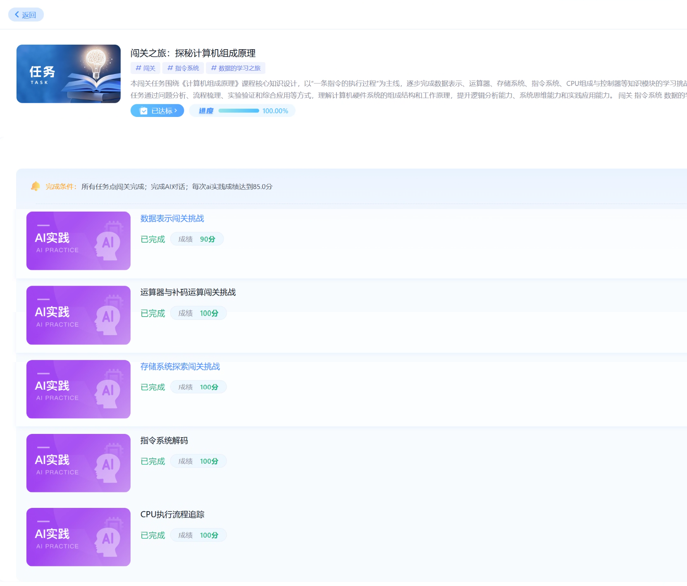

# chaoxing-agent-browser

在 Windows 上使用 agent-browser 接续超星学习通的 AI 阶梯闯关和练习，逐题读取与作答，保存报告并核对最终完成状态。

流程包含当前账号检查、动态标签页和 iframe 处理、计算复核、异常判分记录、结束任务与报告保存。完整操作指引见 [SKILL.md](SKILL.md)。

## 完成状态示例



用户提供的完成状态截图；具体课程的完成条件和成绩以当前页面为准。

## 环境

- Windows x64
- Python 3.10 或更新版本；辅助脚本只依赖标准库
- 已安装的 agent-browser CLI 及其浏览器
- 可加载本地 skill 的 Codex 环境

已在 agent-browser 0.39.1 上验证。CLI 更新后，以本机 `skills get core` 的操作说明及实际页面为准。

## 安装

将整个仓库目录放到 `$CODEX_HOME/skills/chaoxing-agent-browser`；没有设置 `CODEX_HOME` 时，放到用户目录下的 `.codex/skills/chaoxing-agent-browser`。该目录中应直接包含 `SKILL.md`、`agents`、`references` 和 `scripts`。

## 使用

```text
$chaoxing-agent-browser 帮我完成当前登录账号的5个关卡，使用 agent-browser。
```

在可见浏览器窗口中自行登录。更换账号后，skill 会重新读取当前账号和任务状态；题目由模型逐题求解，不包含固定答案表。

`scripts/agent_browser.py` 为 native CLI 包装，保留 URL、ref 和 stdin 参数，要求使用任务独有的命名会话。

`scripts/save_report.py` 只保存当前已打开且完整生成的报告，输出文本、截图及分数元数据，不会结束或重启练习。截图保存后仍需检查。

## 验证

```powershell
python -m unittest discover -s tests -v
```

11 项测试覆盖参数传递、标准输入、会话保护、报告完整性、重复保存保护和截图失败处理。另已通过隔离本地页面的 agent-browser 实测，验证带 `&` 的 URL、中文 stdin、报告提取及截图。

仓库不包含账号凭据、Cookie、浏览器 profile 或认证链接。正常学习操作通过网页控件进行，不修改隐藏答案、成绩或完成状态。
